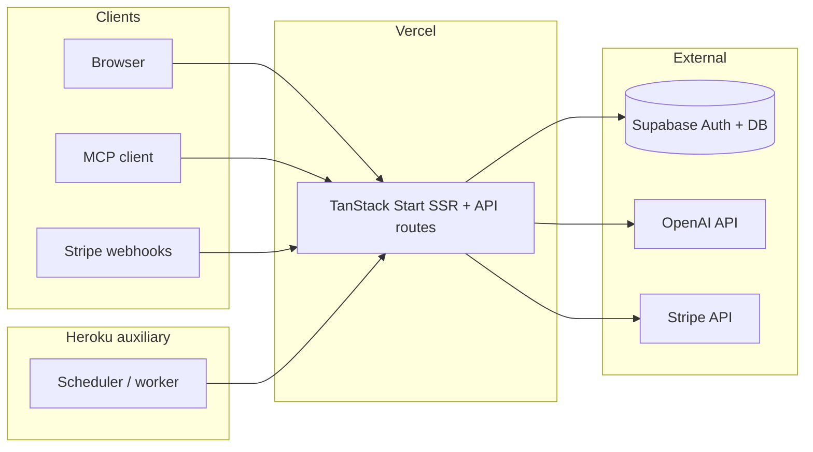

> **Historical:** superseded planning doc; kept for history only.

> **SUPERSEDED (2026-11-03):** this plan assumed Supabase. The current stack is Firebase Auth + Firestore. See `docs/ARCHITECTURE.md` and `docs/DECISIONS.md`. Kept for history only.

## Goal Capsule

**Objective:** Customers can sign in, browse the catalog, purchase memberships and templates, and use the public MCP catalog API on your own domains, with no runtime dependency on Lovable platform packages, preview hosts, or Lovable AI gateway.

**Means:** Replace Lovable build/auth/MCP/AI integrations with TanStack Start + Nitro defaults, Supabase Auth, official MCP SDK (or hand-rolled handlers), direct OpenAI, and dual deploy configs — Vercel for the web app, Heroku for scheduled/cron workloads. (KTD1–KTD4)

**Authority:** Product Contract requirements override convenience; session-confirmed scope defaults below override unstated alternatives.

**Stop conditions:** Do not migrate off Supabase or rewrite catalog content in this program. Do not force-push git history (Lovable sync constraint in AGENTS.md).

**Execution profile:** Phased rollout — decouple locally first, then staging on Vercel, then production cutover with Stripe webhook verification.

## Product Contract

### Summary

Plan removes `@lovable.dev/*` dependencies and Lovable-specific routes/telemetry, replaces them with vendor-neutral equivalents, and adds production launch work (secrets, CI, observability, Stripe + Supabase ops, Vercel + Heroku deploy). Confirmed scope defaults: Vercel primary web; Heroku auxiliary cron/workers; keep OAuth MCP at launch; replace Lovable AI gateway with direct OpenAI.

### Problem Frame

The app was imported from Lovable and still couples to Lovable Vite config, cloud auth wrapper, MCP code generation, AI gateway, preview auth broker, editor error telemetry, and Lovable-prefixed secrets. Privacy copy already names Vercel hosting, but deploy artifacts and build pipeline are not yet owned outside Lovable. Launching as SaaS requires a reproducible build, owned secrets, and production deploy targets without the Lovable sandbox.

### Requirements

- R1. Production builds and local dev must succeed with zero `@lovable.dev/*` npm dependencies.
- R2. Visitor auth continues via Supabase (email + Google); Lovable OAuth provider and Lovable-branded sign-in UI are removed.
- R3. Stripe checkout, webhooks, and membership flows keep working with owned `STRIPE_*` secrets and verified webhook endpoint on production URL.
- R4. Public MCP catalog endpoint (`/mcp`) and OAuth protected-resource metadata remain available for authenticated MCP clients at launch, without the Lovable MCP Vite plugin or auto-generated route banners.
- R5. Product detail AI recommendations use a direct OpenAI (or compatible) API key, with same-category catalog fallback when AI fails (existing behavior in AGENTS.md).
- R6. Primary web traffic serves from Vercel on the production domain; Heroku runs only auxiliary workloads (scheduled jobs hitting Supabase cron routes, optional future workers) — not a second full copy of the SSR app unless explicitly added later.
- R7. Environment variables are documented for operators; Lovable-prefixed names are migrated or aliased with a deprecation window in code.
- R8. CI runs lint, typecheck, and tests on pull requests; production deploy is gated on green main branch.
- R9. Launch checklist covers domain/TLS, Supabase redirect URLs, Stripe webhook URL, cookie/analytics consent (PostHog mentioned in privacy copy), and smoke tests for sign-in, checkout, and MCP metadata.

### Actors

- A1. Anonymous visitor — browse catalog, cookie banner, sign up/in.
- A2. Member — checkout, library, billing portal links.
- A3. MCP client — OAuth against Supabase, calls catalog tools.
- A4. Operator — deploys Vercel/Heroku, rotates secrets, monitors errors.

### Key Flows

- F1. Google/email sign-in → Supabase session → account profile (existing AccountProvider lifecycle).
- F2. Checkout server fn → Stripe session → webhook records purchase.
- F3. MCP client discovers `/.well-known/oauth-protected-resource` → bearer JWT → tool calls search/get product.

### Acceptance Examples

- AE1. Local `npm run dev` starts without Lovable path errors on Windows and macOS.
- AE2. After deploy, Google sign-in completes and account page loads.
- AE3. Stripe test checkout completes; webhook handler returns 2xx for valid signature.
- AE4. MCP metadata document lists Supabase issuer; authenticated tool call returns catalog hits.
- AE5. Product page shows related items when `OPENAI_API_KEY` set; shows fallback list when unset or AI errors.

### Success Criteria

- Zero `@lovable.dev` entries in `package.json` dependencies or devDependencies.
- Production URL serves homepage, sign-in, and `/api/public/stripe-webhook` with documented env vars only.
- Heroku app (if used) only runs declared auxiliary processes; no duplicate SSR unless documented exception.

### Scope Boundaries

**In scope:** Build pipeline, auth integration cleanup, MCP route ownership, AI provider swap, env/secret naming, deploy configs, CI, launch runbook, remove Lovable telemetry/preview hooks.

**Out of scope:** Re-platforming off Supabase; catalog JSON rewrite; new pricing SKUs; mobile apps; full SOC2/compliance program.

### Deferred for later

- Multi-region SSR; CDN asset strategy beyond Vercel defaults.
- Replacing hand-rolled Stripe REST calls with Stripe SDK (optional hardening).
- MCP App UI views if any exist beyond catalog tools.

### Deferred to Follow-Up Work

- Heroku full-stack mirror of SSR (only if Vercel limits block a future requirement).

### Dependencies

- Existing Supabase project (current `.env` keys).
- Stripe account and webhook secret.
- Vercel and Heroku accounts; domain DNS access.
- OpenAI API key (or compatible gateway you control).

### Outstanding Questions

- **Blocking:** None after scope confirmation — defaults recorded under Assumptions.
- **Deferred:** Exact OpenAI model ID to replace `openai/gpt-6-astra` gateway slug (pick at implementation from OpenAI docs + cost/latency).

### Sources

- Repository: `vite.config.ts`, `package.json`, `src/integrations/lovable/`, `src/lib/mcp/`, `src/lib/recommend.server.ts`, `src/routes/signin.tsx`, `src/integrations/supabase/cron-auth.ts`, `drizzle.config.ts`, `src/routes/privacy.tsx`.
- AGENTS.md workspace rules (catalog, auth, MCP OAuth, AI fallback).

## Planning Contract

### Assumptions

- Vercel hosts the single production SSR app; Heroku is cron/auxiliary only (user confirmed scope with defaults).
- MCP catalog API ships at v1 launch (user confirmed scope with defaults).
- Supabase project stays; only env naming and redirect URL updates.
- Direct OpenAI replaces Lovable gateway (user confirmed scope with defaults).

### Key Technical Decisions

- KTD1. **Vercel as primary SSR host.** TanStack Start production build uses Nitro with the Vercel preset (or documented TanStack Start Vercel adapter for the pinned `@tanstack/react-start` version). Chosen over Cloudflare-only Lovable default because privacy copy and operator intent target Vercel.
- KTD2. **Heroku for auxiliary processes only.** A small Node worker or Heroku Scheduler invokes existing Supabase cron-authenticated routes (`LOVABLE_CRON_SECRET` renamed to `CRON_SECRET`); chosen over duplicating SSR on Heroku to limit cost and drift.
- KTD3. **Replace `@lovable.dev/vite-tanstack-config`.** Use upstream TanStack Start + Vite + Nitro configuration explicitly in-repo (`vite.config.ts`, optional `app.config` / Nitro config as required by pinned versions). Chosen over staying on Lovable config wrapper to eliminate hidden sandbox behavior (`LOVABLE_PREVIEW_HOST`, asset proxy, Cloudflare preset pins).
- KTD4. **MCP without `@lovable.dev/mcp-js`.** Own the `/mcp` and `/.well-known/oauth-protected-resource` routes and tool handlers using the official Model Context Protocol SDK (or minimal hand-rolled HTTP handlers mirroring current tool contracts). Remove Vite plugin and delete auto-generated route files’ Lovable banners. Chosen over dropping MCP to preserve SaaS differentiation (R4).
- KTD5. **Supabase-native OAuth only.** Remove `@lovable.dev/cloud-auth-js` and `src/integrations/lovable/`; sign-in uses `supabase.auth.signInWithOAuth` for Google (and existing email flow). Remove “Continue with Lovable” and `/.lovable/oauth/consent` unless still required for third-party MCP consent — if consent UI is only for Lovable editor OAuth, delete route and update tests.
- KTD6. **Direct OpenAI for recommendations.** `src/lib/recommend.server.ts` uses `OPENAI_API_KEY` and official OpenAI base URL; remove `LOVABLE_API_KEY`, `run-id.server.ts` Lovable AIG headers unless still needed for your own observability.
- KTD7. **Env migration table.** Rename `LOVABLE_CRON_SECRET` → `CRON_SECRET`, `LOVABLE_DB_MIGRATION_URL` → `DATABASE_URL` (drizzle), keep `SUPABASE_*` / `VITE_SUPABASE_*`; support old names temporarily via read fallback in server code during cutover.
- KTD8. **Remove Lovable telemetry.** Delete or no-op `lovable-error-reporting.ts`, `webmcp-telemetry.ts` Lovable event names, and `previewAuthStorage.ts` iframe broker unless you still embed in Lovable preview (assume no for launch).

### High-Level Technical Design

**Deploy flow:** PR → CI → merge → Vercel production deploy from main. Heroku deploys only the auxiliary app when cron logic changes. Staging preview on Vercel uses separate env group.

### Sequencing

1. Build/dev baseline without Lovable packages (U1–U3).
2. Auth + AI + MCP behavior parity (U4–U6).
3. Env cleanup + remove dead routes/telemetry (U7).
4. Vercel + Heroku configs and CI (U8–U9).
5. Launch runbook + smoke verification (U10–U11).

### Risks

| Risk                                             | Mitigation                                                                              |
| ------------------------------------------------ | --------------------------------------------------------------------------------------- |
| TanStack Start + Nitro preset mismatch on Vercel | Pin versions; verify with `npm run build` locally and Vercel preview before DNS cutover |
| MCP OAuth parity regression                      | Keep existing Supabase issuer config; add integration test with mocked JWT              |
| Stripe webhook URL change                        | Update Stripe dashboard; run test events in staging                                     |
| Windows dev path bugs (prior mcp-js patch)       | Removed with mcp-js; validate dev on Windows in AE1                                     |
| Secret rename breaks cron                        | Dual-read old/new env names for one release (KTD7)                                      |

## Implementation Units

### U1. Dependency and touchpoint inventory

**Goal:** Single checklist of Lovable couplings and env vars for traceability.

**Requirements:** R1, R7

**Dependencies:** None

**Files:** `package.json`, `package-lock.json`, `patches/`, `vite.config.ts`, `README.md`, `AGENTS.md` (note only if rules change)

**Approach:**

1. Grep repo for `lovable`, `@lovable`, `LOVABLE_`, `__lovable`.
2. Produce inventory table in plan appendix or `docs/lovable-migration-inventory.md` (optional doc — prefer appendix note in PR description).
3. List required production env vars for operators.

**Test scenarios:**

- Test expectation: none — documentation-only unit.

### U2. Replace Lovable Vite / TanStack config

**Goal:** `npm run dev` and `npm run build` work using upstream TanStack Start tooling.

**Requirements:** R1, AE1

**Dependencies:** U1

**Files:** `vite.config.ts`, `package.json`, `src/server.ts`, new `nitro.config` or equivalent if required by pinned TanStack Start

**Approach:**

1. Remove `@lovable.dev/vite-tanstack-config`; add explicit plugins: `@tanstack/router-plugin`, `@tanstack/react-start`, `@vitejs/plugin-react`, `@tailwindcss/vite`, `vite-tsconfig-paths` or native `resolve.tsconfigPaths`.
2. Configure Nitro for Node output suitable for Vercel; document preset choice in commit message.
3. Preserve `tanstackStart.server.entry: "server"` mapping to `src/server.ts` SSR error wrapper.
4. Remove Lovable-only env behavior (`LOVABLE_PREVIEW_HOST`, sandbox strictPort) unless still needed locally.

**Patterns to follow:** Comments in current `vite.config.ts` listing plugins the Lovable bundle included — ensure each capability is accounted for once.

**Test scenarios:**

- Covers AE1. `npm run dev` binds and serves `/` with 200.
- `npm run build` completes without `@lovable.dev` imports.
- Existing vitest suite still runs (`npm test`).

### U3. Environment variable migration

**Goal:** Operator-facing env names with backward-compatible reads.

**Requirements:** R7

**Dependencies:** U1

**Files:** `drizzle.config.ts`, `src/integrations/supabase/cron-auth.ts`, `.env.example` (create), `README.md`

**Approach:**

1. Add `.env.example` listing all required vars (no secrets).
2. Drizzle uses `DATABASE_URL` with fallback to `LOVABLE_DB_MIGRATION_URL`.
3. Cron auth accepts `CRON_SECRET` / `CRON_SECRET_PREVIOUS` with fallback to Lovable names.
4. Document Vercel env groups and Heroku config vars.

**Test scenarios:**

- Unit test cron-auth accepts new secret name when old unset.
- Test expectation: none for drizzle config — validated at migration run time.

### U4. Supabase-only authentication

**Goal:** Remove Lovable cloud auth; keep Google + email sign-in.

**Requirements:** R2, F1, AE2

**Dependencies:** U2

**Files:** `src/routes/signin.tsx`, `src/integrations/lovable/index.ts` (delete), `src/routes/[.]lovable.oauth.consent.tsx` (delete if unused), `src/test/assistant-support.test.ts`, `src/integrations/supabase/client.ts`, `src/integrations/supabase/previewAuthStorage.ts`

**Approach:**

1. Replace `lovable.auth.signInWithOAuth` with `supabase.auth.signInWithOAuth({ provider: 'google' })` and existing email magic link/OTP flows if present.
2. Remove Lovable CSS import and button; adjust layout.
3. Remove preview auth storage broker if not needed outside Lovable iframe.
4. Update Supabase dashboard redirect URLs for production and preview domains.

**Patterns to follow:** `AccountProvider` in `src/lib/account-context.tsx` — do not duplicate session listeners.

**Test scenarios:**

- Covers AE2. Sign-in route renders Google button without Lovable provider.
- `safeReturnPath` tests updated if consent route removed.

### U5. MCP route ownership (no mcp-js)

**Goal:** R4 MCP and OAuth metadata without Lovable MCP package.

**Requirements:** R4, F3, AE4

**Dependencies:** U2

**Files:** `src/routes/mcp.ts`, `src/routes/[.well-known]/oauth-protected-resource.ts`, `src/lib/mcp/index.ts`, `src/lib/mcp/tools/search-catalog.ts`, `src/lib/mcp/tools/get-product.ts`, `package.json`

**Approach:**

1. Remove `@lovable.dev/mcp-js` and Vite `mcpPlugin()`.
2. Reimplement MCP HTTP handler and protected-resource metadata using official MCP SDK or stable hand-rolled handlers preserving tool names/schemas and Supabase JWT validation (`acceptedAudiences: authenticated`, OAuth client claim if still required).
3. Delete “AUTO-GENERATED by @lovable.dev/mcp-js” maintenance model — routes are owned source files.
4. Remove `.lovable/mcp/manifest.json` dependency if present; document MCP URL for operators.

**Test scenarios:**

- Covers AE4. Metadata route returns issuer matching Supabase project ref.
- Tool handler returns catalog search results for valid mocked auth context.
- Unauthorized request returns challenge/metadata consistent with prior behavior.

### U6. Direct OpenAI recommendations

**Goal:** Remove Lovable AI gateway dependency.

**Requirements:** R5, AE5

**Dependencies:** U2

**Files:** `src/lib/recommend.server.ts`, `src/lib/run-id.server.ts` (delete or strip Lovable headers), `src/lib/recommend.functions.ts`, tests for recommend fallback if any

**Approach:**

1. Use `@ai-sdk/openai` with `OPENAI_API_KEY` and standard OpenAI base URL.
2. Pick production model ID explicitly in code constant; keep same-category fallback in server fn on failure (AGENTS.md).
3. Remove `LOVABLE_API_KEY` and gateway headers unless replaced with your own tracing.

**Test scenarios:**

- Covers AE5. When API key missing, server fn falls back without throwing to client.
- When key present, related slugs returned (mock fetch in test).

### U7. Remove Lovable telemetry and error hooks

**Goal:** No runtime calls to Lovable editor telemetry.

**Requirements:** R1

**Dependencies:** U4

**Files:** `src/lib/lovable-error-reporting.ts`, `src/routes/__root.tsx`, `src/lib/webmcp-telemetry.ts`

**Approach:**

1. Replace `reportLovableError` with existing error capture or Sentry/PostHog if already planned — minimum: console + existing `error-capture` pipeline.
2. Remove or genericize webmcp telemetry event names.

**Test scenarios:**

- Test expectation: none — behavior unchanged for users aside from removed editor reporting.

### U8. Vercel production deploy

**Goal:** R6 primary hosting on Vercel with SSR.

**Requirements:** R6, R8, R9

**Dependencies:** U2, U3

**Files:** `vercel.json` (if needed), `package.json` scripts, `README.md`, optional GitHub Actions `.github/workflows/ci.yml`

**Approach:**

1. Add Vercel project linked to repo; set env vars from `.env.example`.
2. Configure build command `npm run build` and output per TanStack Start/Vercel docs for pinned version.
3. Add CI workflow: install, lint, test, build on PR.
4. Document preview deployments for branches.

**Test scenarios:**

- CI workflow passes on clean checkout.
- Manual: Vercel preview URL passes smoke (home, sign-in page load).

### U9. Heroku auxiliary app

**Goal:** R6 cron/scheduled workloads on Heroku without duplicating SSR.

**Requirements:** R6

**Dependencies:** U3, U8

**Files:** `Procfile`, `heroku.yml` or scheduler docs, optional `scripts/cron-trigger.ts`, `README.md`

**Approach:**

1. Define Heroku app with scheduler entry hitting authenticated cron routes (reuse `cron-auth.ts`).
2. Document that SSR stays on Vercel; Heroku does not serve public traffic unless requirement changes.
3. Set Heroku config vars mirroring cron secrets.

**Test scenarios:**

- Cron auth rejects missing secret.
- Scheduler dry-run against staging URL returns expected status with valid secret.

### U10. Stripe and SaaS launch runbook

**Goal:** R3, R9 production readiness.

**Requirements:** R3, R9

**Dependencies:** U8

**Files:** `src/routes/api/public/stripe-webhook.ts`, `src/lib/stripe.server.ts`, `src/lib/checkout.functions.ts`, `docs/runbooks/launch.md` (new), `src/routes/privacy.tsx` (verify provider list only)

**Approach:**

1. Register production webhook URL on Stripe; rotate `STRIPE_WEBHOOK_SECRET`.
2. Smoke test checkout paths in test mode on Vercel URL.
3. Write launch runbook: DNS, Supabase redirects, Stripe, cookie banner, PostHog (if used), rollback steps.

**Test scenarios:**

- Covers AE3. Webhook signature verification rejects invalid signature (existing tests in `src/test/checkout-plans.test.ts` extended if needed).
- Checkout server fn creates session when Stripe key present (mock).

### U11. Final dependency purge and AGENTS.md update

**Goal:** R1 complete; contributor docs accurate.

**Requirements:** R1, R8

**Dependencies:** U2–U7

**Files:** `package.json`, `package-lock.json`, `AGENTS.md`, `README.md`, remove `patches/` if empty

**Approach:**

1. Verify zero `@lovable.dev` in lockfile.
2. Update AGENTS.md bullets that reference Lovable MCP SDK transport if implementation changes.
3. README local dev steps without Lovable.

**Test scenarios:**

- `npm ci` on clean machine succeeds.
- Grep CI step fails build if `@lovable.dev` reintroduced (optional script).

## Verification Contract

**Local**

- `npm run lint`
- `npm test`
- `npm run build`

**Pre-production**

- Vercel preview: AE2, AE3 (test mode), AE4 manual MCP check
- Heroku scheduler dry-run against staging cron route

**Production smoke**

- Homepage, sign-in, member checkout happy path, webhook test event, MCP metadata fetch

## Definition of Done

**Global**

- All U1–U11 complete; no `@lovable.dev/*` dependencies.
- Production on Vercel; Heroku auxiliary documented and running if cron required.
- Launch runbook executed once on staging and once on production.
- Open questions on model ID resolved and recorded in runbook.

**Per unit**

- Each unit’s test scenarios satisfied or explicitly waived with reason.
- No launch-blocking Outstanding Questions remain.

## Appendix

### Lovable coupling inventory (repo snapshot 2026-11-03)

| Area                 | Location                                                  | Replacement direction     |
| -------------------- | --------------------------------------------------------- | ------------------------- |
| Vite/TanStack bundle | `@lovable.dev/vite-tanstack-config`, `vite.config.ts`     | U2 upstream config        |
| MCP SDK + plugin     | `@lovable.dev/mcp-js`, generated routes                   | U5 owned handlers         |
| Cloud auth           | `@lovable.dev/cloud-auth-js`, `src/integrations/lovable/` | U4 Supabase OAuth         |
| AI gateway           | `LOVABLE_API_KEY`, `recommend.server.ts`                  | U6 OpenAI                 |
| Cron secrets         | `LOVABLE_CRON_SECRET*`                                    | U3 `CRON_SECRET*`         |
| DB migrations        | `LOVABLE_DB_MIGRATION_URL`                                | U3 `DATABASE_URL`         |
| Telemetry            | `lovable-error-reporting`, `webmcp-telemetry`             | U7 remove/genericize      |
| Preview auth         | `previewAuthStorage.ts`                                   | U4 remove if unused       |
| OAuth consent route  | `[.]lovable.oauth.consent.tsx`                            | U4 delete if Lovable-only |
| Windows patch        | `patches/@lovable.dev+mcp-js*`                            | Removed with U5           |

### Confidence check

Confidence check passed for a Deep plan — external research deferred; TanStack Start deploy details must be validated against official docs during U2/U8 implementation (pinned `@tanstack/react-start@1.168.60`). No deepening pass requested.
